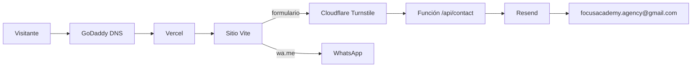
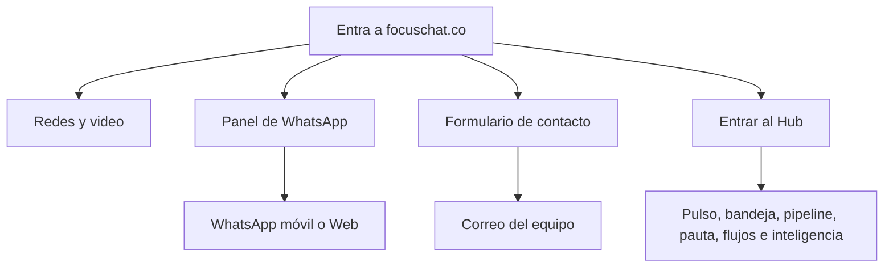
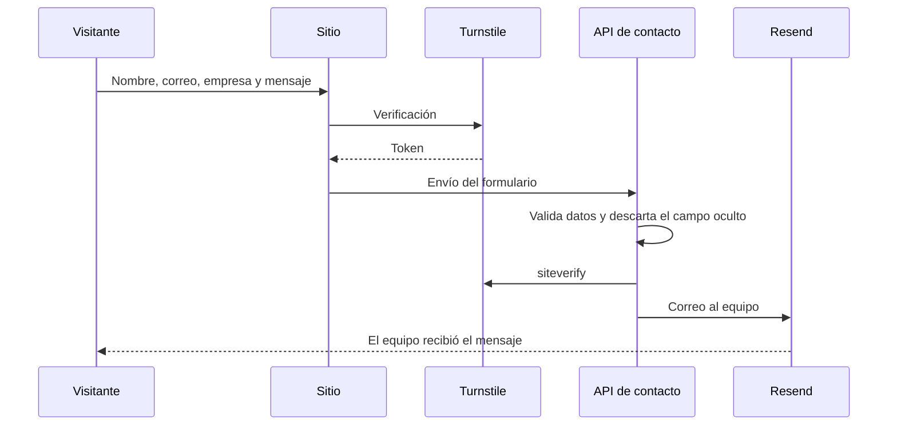
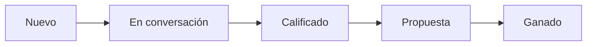
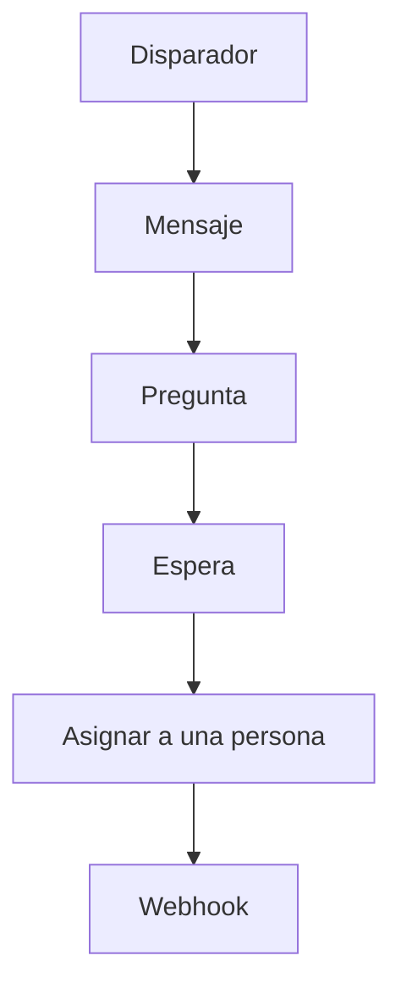

# Focus Agency

Sitio público y Hub de Focus Chat & Agency. Producción: [focuschat.co](https://focuschat.co).

## Infraestructura



El dominio `focuschat.co` apunta a Vercel. El sitio es una aplicación Vite + React. El formulario vive en una función de Vercel: Turnstile confirma que hay una persona y Resend entrega el mensaje desde `hola@focuschat.co`. El botón de WhatsApp abre el chat de Focus Agency Marketing en el teléfono `573106309679`, con el texto que escribió el visitante.

Variables de producción, solo en Vercel: `RESEND_API_KEY`, `TURNSTILE_SECRET_KEY`, `TURNSTILE_SITE_KEY` y `CONTACT_FROM`. El buzón de destino es `focusacademy.agency@gmail.com`.

## Llegada del visitante



## Formulario de contacto



Un envío incompleto responde que hay que revisar los datos. Si la verificación falla, pide confirmar que no es un robot. El campo oculto `fax` corta el envío de bots sin avisarles.

## Hub

El Hub guarda leads, conversaciones, campañas, flujos e integraciones en el navegador (`focus-hub-mvp-2`). WhatsApp Business, Instagram y Meta Ads de esa vista usan datos de demostración.

| Ruta | Lectura |
| --- | --- |
| `/hub` | Pulso del negocio |
| `/hub/bandeja` | Conversaciones |
| `/hub/pipeline` | Etapas del lead |
| `/hub/ads` | Pauta |
| `/hub/flujos` | Secuencias |
| `/hub/integraciones` | Canales y destinos |
| `/hub/inteligencia` | Qué convierte y qué se enfría |

## Pipeline



Canales de entrada: WhatsApp, Instagram, Meta Ads y Web.

## Flujos

Cada flujo tiene un disparador, un canal y pasos ordenados. Los pasos posibles son mensaje, pregunta, espera, asignar y webhook.



La demostración trae cinco secuencias: bienvenida de WhatsApp, calificación de intención, seguimiento a las 24 h, aviso de lead caliente y nutrición de propuesta.

## Local

```bash
npm install
npm run dev
```

El sitio queda en `http://localhost:5173/`.
